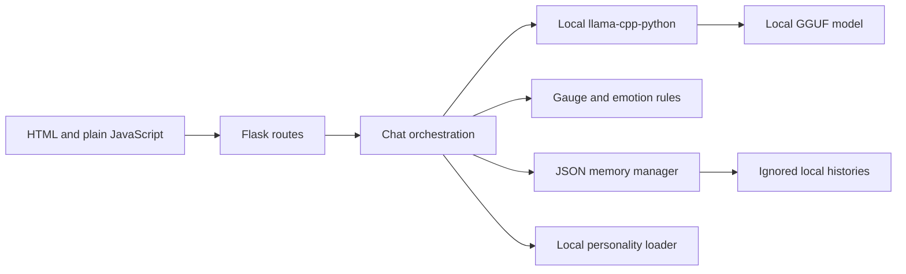

# Architecture

## Current implementation

`frontend_app.py` imports the chat engine, which imports and initializes the model and personality immediately. Chat state and recent history are process globals. The browser calls `/api/status` and `/api/chat`. Each successful chat currently writes the same event twice. `core/state.py` is a second, currently disconnected state implementation.

`backend/image_gen.py` creates image metadata and its output directory; no current route invokes a ComfyUI service. The architecture diagram shows the active chat path, not a planned image pipeline.

## M1 target, not yet implemented

Keep the stack and introduce explicit settings, a web app factory, one session state owner, an injected inference adapter and a single memory writer. The status route should remain available before model assets are ready. Separate transport, prompt construction, state updates and persistence enough to test them with temporary storage and fake inference.

See [plan 001](specs/001-reliable-local-chat/plan.md) and its [HTTP contract](specs/001-reliable-local-chat/contracts/http.md). Those documents define proposed behavior; they do not describe completed code.

## Data boundaries

Source, synthetic examples, feature specs and shared development tooling belong in Git. Private personality data, local conversation state, weights, caches and generated media do not. No production family data should depend on Incanta. External SSD paths are configuration, not repository-owned assets.

## Later decisions

Memory migrations, multiple sessions, personality validation and optional ComfyUI each need their own specification. React, FastAPI, cloud services and database changes are not implied by this diagram or roadmap. Reuse in Butler requires a separate dependency, security and persistence audit.
