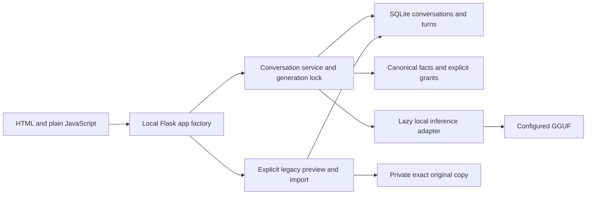

# Architecture

## Active companion implementation

`frontend_app.create_app()` constructs injectable services without reading private assets or opening/creating the database. Status checks do not load the model. Empty conversation listing does not create a database. `ConversationStore` opens one connection per operation, enables foreign keys and full synchronous writes, and validates schema version; it never resets an existing unreadable database. Schema creation occurs on explicit first write. An existing v1 database upgrades to v2 in one transaction. One app process is supported.

`ConversationService.process` validates message/request/conversation IDs, takes one nonblocking generation lock, snapshots settings/context revisions and scoped facts/dialogue, then closes the read transaction before inference. Structured messages contain the selected personality, relationship and content boundaries. A conservative UTF-8 byte budget reserves output/format overhead, selects fitting current facts and trims oldest turns. Oversized irreducible setup/message returns a controlled error.

After generation, a write transaction rechecks revisions and atomically commits one turn plus gauges/emotion. Same request UUID/message replays the committed response without generation; another message with that identifier conflicts. Fact/settings edits can proceed during inference and invalidate its pending commit. Stale output is never saved as a current successful turn.

`FactStore` owns canonical facts and explicit grants. Only the selected conversation's granted current facts enter retrieval; no cross-chat transcript/personality/relationship sharing occurs. Corrections update one record. Deletion removes content and grants, leaving only a content-free tombstone; recipients' context revisions change transactionally. Historical turns and older backups are not rewritten. There is no automatic generated-fact extraction or sibling heuristic in this active path.

`LegacyImporter` reads one configured source only after preview. Confirmation revalidates its checksum, atomically preserves exact bytes (including unknown fields), and imports a conversation/turns/checksum record transactionally. Original duplicates are retained. Repeated confirmation cannot duplicate a committed import. Preview tokens are local, bounded and expire; corrupt/changed sources and backup failures preserve originals.

## Browser and HTTP boundaries

The plain-JavaScript UI provides a short setup form, conversation switch/resume, literal text transcript, memory inspect/correct/delete/sharing controls and explicit import confirmation. Browser storage contains only the last selected opaque conversation ID. Transport helpers retain request IDs for explicit retry and reject obsolete view responses after chat switches.

Mutations require an exact local Origin, signed local session and CSRF token from `/api/bootstrap`; there is no new multi-user identity service or CORS expansion. Cookies contain no private dialogue/settings. Session tokens rotate on process restart; reload bootstraps again. API/error responses are no-store with safe error categories. The status endpoint does not promise model generation success merely because assets are available.

## Local portrait and scene pipeline

Flask and the background worker use the existing SQLite store. Each job is attached to an opaque conversation and request ID with a snapshot of settings, facts and the visual identity revision. One active render is reserved durably before submission. A timeout leaves an uncertain job that must be correlated by Incanta ownership metadata in ComfyUI queue/history or explicitly resolved. Pending deletion is targeted. A running job marked for cancellation finishes without publishing an image.

The worker validates the local resolved workflow and its node bindings, submits the prompt only to the configured loopback renderer and fetches a bounded owned result from `/view`. A decoded PNG, JPEG or WebP is saved atomically in a private directory under an opaque file key. The job and validated image metadata commit together after another context check. Asset reads require committed metadata, a matching checksum and a regular file reached without symlinks. Portrait approval is a separate owner action.

One local heavy-work lease coordinates foreground chat and manual and automatic images. The worker closes the local LLM before submission. A durable handoff record prevents a restarted app from loading chat while the previous renderer may still own resources. The dedicated renderer receives `/free`; two small model-free jobs prove its worker crossed the release boundary and completed the intervening cache reset. Native fit depends on measured memory. Automatic scenes are opt-in. Only a bounded scene proposal from a committed turn can enter the coalescing queue, and it never creates a memory fact.

## Compatibility and deferred work

`create_app(legacy=True)` is an explicit M1 test/smoke compatibility harness. Its old JSON engine/contract is not the default running app; default `/api/chat` requires conversation selection. M1 tests select this harness, while new 002 suites test the active factory. `core/state.py` remains inactive. The gauge rules retain documented existing precedence with Neutral fallback.

The recovered metadata-only `backend/image_gen.py` is inactive in the companion app. Proactive follow-ups and native Mac notifications are planned in 004. Full consistent backup/restore tooling is 005. Atomic SQLite transactions and preserved import copies do not replace application backups or certify power-loss behavior. Native crashes, model obedience/quality and multi-process coordination need separate evidence/design.

See [002 contract](specs/002-companion-conversations/contracts/http.md), [verification](specs/002-companion-conversations/verification.md) and [decisions](DECISIONS.md). Butler reuse remains a separate review.
