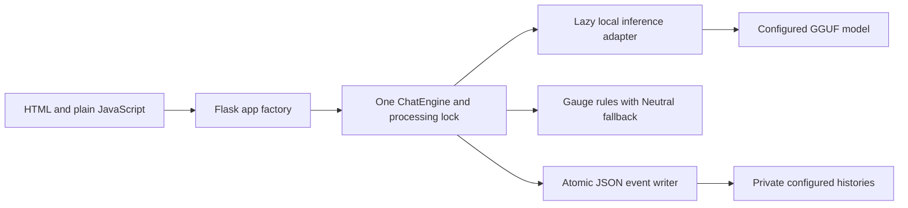

# Architecture

## Active M1 implementation

`frontend_app.create_app` wires settings, injectable inference and one state owner without reading private assets. Status checks configured availability without loading the model; the first valid chat request loads it lazily. Configured model state and inference readiness are separate from a guarantee that generation succeeds.

The engine validates input, rejects overlapping turns, loads character/history, constructs a prompt and generates tentative state. It appends one event through a same-directory temporary file, flush/fsync and atomic replacement, then publishes state with one assignment. Failed generation or persistence preserves prior committed state/history. Status can still respond while a turn is processing.

The browser shares small rendering/request helpers with Node tests. Conversation text uses text nodes, not HTML parsing. It checks HTTP status, handles failure and restores controls in a finally block. A late status response cannot overwrite a newer chat state's gauges.

## Supported scope

One local owner/process and active conversation. Multiple workers, session isolation, request idempotency across manual retries and durable gauge/recent-dialogue restoration are not implemented. File replacement is not a backup, full power-loss guarantee or multi-process lock. Native-library crashes are outside Python exception recovery.

`core/state.py` remains an inactive legacy alternative; it does not own active chat state. The active gauge engine retains its existing non-neutral order with Neutral moved to the end. Soft variation is injectable for deterministic tests.

## Deferred components

Personality JSON must be a readable object, but its fields still do not drive the prompt; that schema/integration is M3. Query-aware retrieval, factual-memory heuristics and retention/recovery policy are M2. `backend/image_gen.py` still writes metadata only and is not a chat/ComfyUI adapter. React, FastAPI, cloud inference and database migrations are not introduced.

## Data and verification

Model, personality and history locations are local environment settings, including SSD paths; private contents never belong in source/CI. Existing stored fields and duplicate entries are preserved. Tests use fake inference, synthetic configuration and temporary histories. See [HTTP contract](specs/001-reliable-local-chat/contracts/http.md), [verification](specs/001-reliable-local-chat/verification.md) and [decisions](DECISIONS.md). Reuse in Butler needs a separate security/dependency/persistence review.
